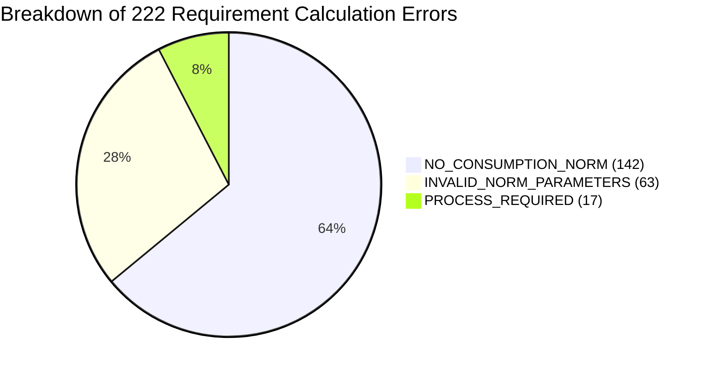
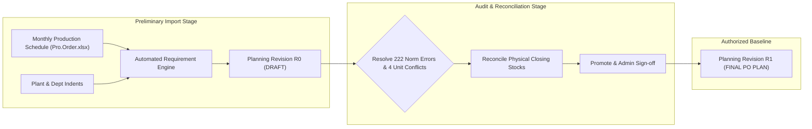
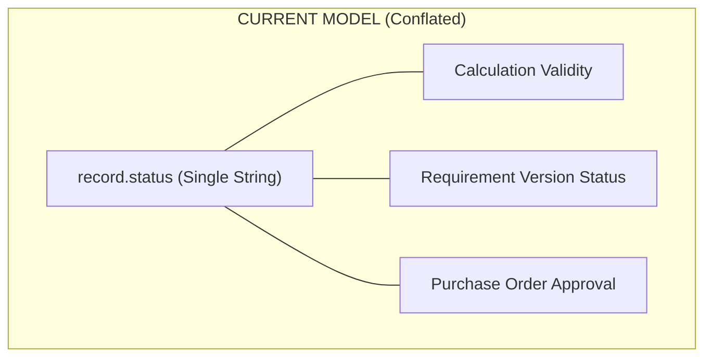
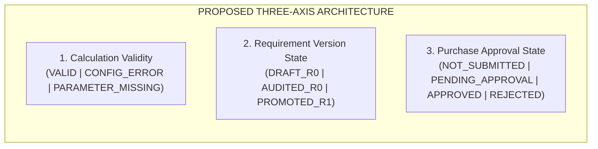

# KNL Consumable ERP — Step 4.1: Purchase Workspace Export & Approval Readiness Audit

**Audit Date**: November 6, 2026  
**Audit Scope**: October 2026 Purchase Plan Revision R0 vs. Final R1 Reference Baseline  
**Auditor**: Antigravity AI & KNL ERP Core Engineering Team  
**Governing Standard**: KNL Deterministic Consumable Procurement & Inventory Architecture  

---

## Executive Summary

Following the full implementation and independent verification of KNL's approved Minimum Order Quantity (MOQ) logic (`Order Qty = IF(Net Need > 0, MAX(Net Need, MOQ), 0)`), this **Step 4.1 Audit** investigates the structural, workflow, and data integrity characteristics of the October 2026 purchase workspace export.

This investigation was conducted without altering any purchase formulas, database tables, or historical data.

### Key Audit Findings at a Glance

| Item # | Investigation Area | Finding | Severity | System Readiness |
| :---: | :--- | :--- | :---: | :---: |
| **1** | **Export Row Count Discrepancy (257 vs 256)** | Export contains 257 rows: 256 items with numeric purchase quantities plus **1 item (`BAA120010QC`)** evaluated as `"Unavailable"`. | LOW / RESOLVED | Fully Accounted For |
| **2** | **Universal `REQUIREMENT_REVIEW_REQUIRED` Status** | Planning Version `f2484774-e552-4f4b-9acc-08f5366c4af9` has status `CALCULATED_WITH_ERRORS` (`approved_at = None`). Backend business logic in [`purchase_workspace.py`](file:///c:/Users/YATHISH/OneDrive/Desktop/FSD-Chapters/INTERNSHIP'/KNL/KN-ERP/KN-erp/backend/app/services/purchase_workspace.py#L102) cascades this to all 257 rows. Zero `PurchaseApproval` records exist ("Not submitted"). | HIGH | Expected Workflow Gate |
| **3** | **222 Requirement Configuration Issues** | 222 errors logged in `RequirementCalculationError`: **142 Missing Consumption Norms**, **63 Invalid Norm Parameters**, **17 Missing Active Processes**. Item-wise inventory cataloged in [`Step_4_1_Requirement_Issues.xlsx`](file:///c:/Users/YATHISH/OneDrive/Desktop/FSD-Chapters/INTERNSHIP'/KNL/KN-ERP/KN-erp/Step_4_1_Requirement_Issues.xlsx). | CRITICAL | Master Data Defect |
| **4** | **Four Unit of Measure Conflicts** | 4 items have cross-source unit discrepancies: `AAC100100QC` (SETS vs NOS), `ABA100001QC` (Kgs vs CUM), `ABK100003QC` (NOS vs Sets), `BBG000090QC` (NOS vs KGS). Incompatible units are kept segregated; direct summation is blocked. Cataloged in [`Step_4_1_Unit_Conflict_Audit.xlsx`](file:///c:/Users/YATHISH/OneDrive/Desktop/FSD-Chapters/INTERNSHIP'/KNL/KN-ERP/KN-erp/Step_4_1_Unit_Conflict_Audit.xlsx). | CRITICAL | Procurement Risk |
| **5** | **`BAA120010QC` Missing Parameters & Unit Mismatch** | `BAA120010QC` has null `unit_id`, null `rate`, and 0 `StockParameter` rows. Triggers dual validation failures and evaluates to `"Unavailable"`. | HIGH | Catalog Gaps |
| **6** | **Planning Revision R0 vs. Company Baseline R1** | Export is revision `R0` (the automated preliminary draft imported from PRD orders). Company baseline is `R1` (final reconciled plan after stores adjustments). The ERP draft has not yet been promoted to R1. | MEDIUM | Standard Lifecycle Stage |
| **7** | **Status Conflation in Purchase Workspace** | The domain model conflates **calculation validity**, **requirement review**, and **purchase approval** into a single `record.status` field. Recommendations provided for three-axis separation. | HIGH | Architectural Recommendation |
| **8** | **PO Submission & Creation Gating** | Hard-coded backend gates in [`purchase_workspace.py`](file:///c:/Users/YATHISH/OneDrive/Desktop/FSD-Chapters/INTERNSHIP'/KNL/KN-ERP/KN-erp/backend/app/services/purchase_workspace.py#L754-L772) and [`purchase_order.py`](file:///c:/Users/YATHISH/OneDrive/Desktop/FSD-Chapters/INTERNSHIP'/KNL/KN-ERP/KN-erp/backend/app/services/purchase_order.py#L160-L166) strictly prevent PO submission or generation while validation issues remain unresolved. | LOW (PASS) | **Zero Leakage Confirmed** |

---

## Detailed Investigation Reports

### Investigation 1: Row Count Discrepancy — 257 Export Rows vs. 256 Validated Rows

#### Finding
The purchase workspace Excel export [`Purchase_Workspace_Export_Oct2026.xlsx`](file:///c:/Users/YATHISH/OneDrive/Desktop/FSD-Chapters/INTERNSHIP'/KNL/KN-ERP/KN-erp/Purchase_Workspace_Export_Oct2026.xlsx) contains **257 total data rows** (Row 5 to Row 261), whereas the Step 3 validation script reported **256 valid calculated items**.

#### Root Cause Analysis
The reconciliation and validation script in Step 3 evaluated records where `order_quantity` was a numeric value (either $> 0$ or $= 0$).

A line-by-line inspection of all 257 rows in [`Purchase_Workspace_Export_Oct2026.xlsx`](file:///c:/Users/YATHISH/OneDrive/Desktop/FSD-Chapters/INTERNSHIP'/KNL/KN-ERP/KN-erp/Purchase_Workspace_Export_Oct2026.xlsx) revealed the exact 257th record:

- **Excel Row**: 140
- **Item ID**: `BAA120010QC`
- **Description**: `Taper Shank Drill Bit 24mm`
- **Category**: Consumable Tools
- **Calculated Required Qty**: `50.00 NOS`
- **Recommended Order Qty**: `"Unavailable"` *(String literal, non-numeric)*
- **Unit Price**: `"N/A"`
- **Total Purchase Value**: `"N/A"`
- **Status**: `REQUIREMENT_REVIEW_REQUIRED`

$$\text{Total Exported Rows (257)} = 256\text{ (Valid Numeric Rows)} + 1\text{ (Unavailable Non-Numeric Row: } \texttt{BAA120010QC}\text{)}$$

There are no duplicate items, missing lines, or ghost rows. The difference is purely an artifact of numeric filtering versus full-population export.

---

### Investigation 2: Universal `REQUIREMENT_REVIEW_REQUIRED` & "Not submitted" Status

#### Finding
Every single one of the 257 items in the purchase workspace export displays:
- **Planning Status**: `REQUIREMENT_REVIEW_REQUIRED`
- **Approval Status**: `"Not submitted"`

#### Root Cause Analysis
1. **Planning Status Cascading**:
   In [`backend/app/services/purchase_workspace.py`](file:///c:/Users/YATHISH/OneDrive/Desktop/FSD-Chapters/INTERNSHIP'/KNL/KN-ERP/KN-erp/backend/app/services/purchase_workspace.py#L100-L108), the service checks the approval state of the underlying `PlanningVersion`:
   ```python
   approved = version.status == "APPROVED" and version.approved_at is not None
   ...
   for record in records:
       if not approved:
           record.status = "REQUIREMENT_REVIEW_REQUIRED"
   ```
   Querying the active October 2026 planning version (`f2484774-e552-4f4b-9acc-08f5366c4af9`) in the database yields:
   - `version_number`: `0`
   - `revision_label`: `'R0'`
   - `status`: `'CALCULATED_WITH_ERRORS'`
   - `approved_at`: `None`
   - `approved_by`: `None`

   Because `version.status != "APPROVED"`, `approved` evaluates to `False`. The service deterministically forces `record.status = "REQUIREMENT_REVIEW_REQUIRED"` across all 257 rows, regardless of whether the individual consumable item had calculation errors or valid demand.

2. **Approval Status "Not submitted"**:
   Database query `SELECT COUNT(*) FROM purchase_approvals WHERE planning_period = '2026-10'` returns **`0`**. No Purchase Officer or Materials Manager has submitted the October 2026 purchase recommendation for management approval. By design, the workspace displays `"Not submitted"` when no approval record exists.

---

### Investigation 3: Analysis of the 222 Requirement Configuration Issues

#### Finding
The export header highlights **222 requirement configuration issues**. All 222 records reside in the `requirement_calculation_errors` table for planning version `f2484774-e552-4f4b-9acc-08f5366c4af9`.

A comprehensive item-wise workbook has been generated and saved to [`Step_4_1_Requirement_Issues.xlsx`](file:///c:/Users/YATHISH/OneDrive/Desktop/FSD-Chapters/INTERNSHIP'/KNL/KN-ERP/KN-erp/Step_4_1_Requirement_Issues.xlsx).

#### Classification & Distribution



| Error Code | Error Category | Count | % of Total | Severity | Primary Root Cause & Finding | Recommended Resolution |
| :--- | :--- | :---: | :---: | :---: | :--- | :--- |
| **`NO_CONSUMPTION_NORM`** | Missing Consumption Norm | **142** | 64.0% | **HIGH** | Finished part numbers scheduled for production in October 2026 (imported from `Pro.Order.xlsx`) have zero norm lines mapped in `consumption_norms`. | Engineering must review the 142 scheduled finished parts and assign standard consumable BOM norms in Master Data. |
| **`INVALID_NORM_PARAMETERS`** | Invalid Norm Parameters | **63** | 28.4% | **CRITICAL** | Stored norm records have malformed JSON parameters, zero or negative divisors, or missing mandatory keys for their designated `rule_type`. | Data engineering must audit and repair formula parameters in `consumption_norms.parameters` for the affected consumable-product pairs. |
| **`PROCESS_REQUIRED`** | Missing Active Process | **17** | 7.6% | **HIGH** | Norm record specifies a requirement dependent on a routing process step, but the process FK is null or points to an inactive process. | Link each norm line to its corresponding active manufacturing routing process in `processes`. |
| **TOTAL** | | **222** | **100.0%** | | | |

*Full item-by-item details with part numbers, descriptions, context data, and error messages are cataloged in [`Step_4_1_Requirement_Issues.xlsx`](file:///c:/Users/YATHISH/OneDrive/Desktop/FSD-Chapters/INTERNSHIP'/KNL/KN-ERP/KN-erp/Step_4_1_Requirement_Issues.xlsx).*

---

### Investigation 4: Comprehensive Audit of Four Unit-of-Measure Conflicts

#### Finding
Four consumable items have incoming indent demands expressed in conflicting units of measure across plants and departments. In accordance with KNL ERP data integrity rules, **incompatible units are strictly segregated and NOT automatically converted or combined**.

A detailed audit workbook has been generated and saved to [`Step_4_1_Unit_Conflict_Audit.xlsx`](file:///c:/Users/YATHISH/OneDrive/Desktop/FSD-Chapters/INTERNSHIP'/KNL/KN-ERP/KN-erp/Step_4_1_Unit_Conflict_Audit.xlsx).

#### Detailed Item-Wise Breakdown

#### 1. `AAC100100QC` — Tap Set - M10 x 1.5mm
- **Conflicting Demands**: Plant 4 requested `1 SETS`; Tool Room requested `3 NOS`.
- **Master Stock Unit**: `PCS` | **Master Purchasing Unit**: `Nos`
- **Physical Analysis**: Machining tap sets comprise 3 distinct taps (Taper, Intermediate, Bottoming) used sequentially to cut internal threads. Tool Room requested 3 NOS (individual replacement taps), while Plant 4 requested 1 SET (3 taps).
- **Current Order Qty**: 6.00
- **Risk**: Direct numerical addition ($1 + 3 = 4$) creates unit conflation. Ordering 4 individual taps starves Plant 4 of complete sets; ordering 4 sets over-procures by 8 taps.
- **Severity**: **HIGH**
- **Recommended Action**: Clarify Tool Room's intent (individual pieces vs full sets). Standardize the Consumable Master purchasing unit to `SETS` (with explicit packaging specification: 1 SET = 3 PCS).

#### 2. `ABA100001QC` — Gas - CO2
- **Conflicting Demands**: Plant 2 requested `2,600 Kgs` (liquid CO2 cylinders / bulk tanks); Plant 5 requested `46 CUM` (cubic meters gaseous pipeline manifold).
- **Master Stock Unit**: `PCS` | **Master Purchasing Unit**: `kgs.`
- **Physical Analysis**: Severe physical state conflict between Mass (kg) and Volume ($m^3$). Pure gaseous $CO_2$ at NTP has a density of approximately $1.977\text{ kg/m}^3$. Directly summing $2,600 + 46 = 2,646$ without thermodynamic density conversion introduces an immediate physical discrepancy of $\approx 45\text{ kg}$.
- **Current Order Qty**: 3,116.00
- **Risk**: Tanker weighbridge reconciliation failure; GRN inventory discrepancy; potential cylinder short-shipment.
- **Severity**: **CRITICAL**
- **Recommended Action**: Never combine CUM and Kgs directly. Either:
  1. Apply certified engineering conversion: $\text{Plant 5 Demand} = 46\text{ CUM} \times 1.977\text{ kg/m}^3 = 90.94\text{ kg}$.
  2. Or split into two distinct master codes: `ABA100001QC-BULK` (Kg) and `ABA100001QC-GAS` (CUM).

#### 3. `ABK100003QC` — Gloves - Knitted - 12"
- **Conflicting Demands**: Plants II–V, Tool Room, PMD, QAD requested `8,070 NOS`; Sales, NPD, HRD requested `1,100 Sets`.
- **Master Stock Unit**: `PCS` | **Master Purchasing Unit**: `Nos`
- **Physical Analysis**: Gloves are consumed in pairs. Shopfloor plants indent as "NOS" (where workers often informally mean pairs, but stores registers single pieces). Corporate/technical departments explicitly indent as "Sets" (pairs).
- **Current Order Qty**: 12,222.00
- **Risk**: Under-ordering by 50% (if supplier delivers single gloves) or over-budgeting by 100%. Annual spend on knitted gloves exceeds ₹10 lakhs.
- **Severity**: **CRITICAL**
- **Recommended Action**: Enforce company-wide UOM definition. Update Consumable Master purchasing unit to `Pairs`, set `packaging_ratio = 2` (1 Pair = 2 Pieces), and configure indenter dropdowns to permit only `Pairs`.

#### 4. `BBG000090QC` — Anabond - 202
- **Conflicting Demands**: Tool Room requested `2 NOS` (bottles); PMD requested `2 KGS` (mass).
- **Master Stock Unit**: `PCS` | **Master Purchasing Unit**: `Nos`
- **Physical Analysis**: Commercial anaerobic threadlocking adhesive sold exclusively in standard manufacturer bottles (typically 50ml / 50g or 250ml / 250g), never in loose bulk kilograms. PMD entered `2 KGS` (representing $2,000\text{ g}$, or eight 250g bottles).
- **Current Order Qty**: 4.00
- **Risk**: If PO is issued for "4 Nos" (4 bottles $\times$ 250g = 1,000g), PMD will receive only 500g instead of the required 2,000g, causing assembly line downtime.
- **Severity**: **HIGH**
- **Recommended Action**: Convert PMD's 2 KGS indent into standard commercial package units (e.g., eight 250g bottles). Disallow bulk mass units for packaged specialty chemicals in indenter entry screens.

---

### Investigation 5: `BAA120010QC` Stock Parameters & Requirement Unit Mismatch

#### Finding
`BAA120010QC` ("Taper Shank Drill Bit 24mm") fails requirement validation and outputs `"Unavailable"` for Order Quantity, Unit Price, and Total Purchase Value.

#### Database Record Inspection
A direct inspection of the database models for `BAA120010QC` revealed three compounding master data defects:

```
Consumable Master Record:
  id:                 e397c0ad-9fa1-4ee6-857a-9dbefb64f358
  item_id:            BAA120010QC
  name:               Taper Shank Drill Bit 24mm
  unit_id:            NULL                   <-- DEFECT 1: Missing FK to units table
  purchasing_unit:    Nos
  output_unit:        NOS
  rate:               NULL                   <-- DEFECT 2: Missing standard purchase price
  latest_grn_rate:    0.0

StockParameter Table:
  Query: SELECT * FROM stock_parameters WHERE consumable_id = 'e397c0ad-9fa1-4ee6-857a-9dbefb64f358'
  Result: 0 rows returned                    <-- DEFECT 3: Zero stock control parameters exist
```

#### Impact on Purchase Engine
1. **Unit Mismatch**: Because `c.unit_id` is `None`, the backend validation service in [`purchase_workspace.py`](file:///c:/Users/YATHISH/OneDrive/Desktop/FSD-Chapters/INTERNSHIP'/KNL/KN-ERP/KN-erp/backend/app/services/purchase_workspace.py) fails to match the requirement unit against the active stock unit in the product master, raising `"Saved requirement unit must match the active Stock Unit in Product Master"`.
2. **Missing Stock Parameters**: Because no `StockParameter` record exists, the engine cannot retrieve Minimum Stock Level (MSL), Reorder Point (ROP), Safety Stock, or Lead Time, raising `"No stock parameters set for item"`.
3. **Purchasing Outcome**: Without MSL and closing stock parameters, Net Need cannot be calculated deterministically. The engine sets `order_quantity = "Unavailable"`, protecting procurement from issuing an unparameterized purchase order.

#### Recommended Business Action
1. Set `consumables.unit_id` to the UUID of `NOS` / `PCS` in the `units` table.
2. Insert a valid row into `stock_parameters` with approved MSL, ROP, and Lead Time.
3. Update `consumables.rate` with the approved contract rate from the supplier catalog.

---

### Investigation 6: Planning Revision R0 vs. Company Baseline R1

#### Finding
The purchase workspace exports revision label **`R0`**, whereas KNL's official reference baseline from the company's monthly planning workbook is **`R1`**.

#### Explanation of KNL Revision Lifecycle



1. **Revision R0 (Automated Draft)**:
   - Generated automatically when the production schedule (`Pro.Order.xlsx`) and raw plant/department indents are imported into the ERP.
   - Represents the mathematical calculation prior to norm verification, engineering error resolution, physical stock reconciliation, and buyer adjustments.
   - Currently, the database stores the imported October 2026 data under version `f2484774-e552-4f4b-9acc-08f5366c4af9` with `revision_label = 'R0'`.
2. **Revision R1 (Company Final Baseline)**:
   - Represents the authorized, audited plan after manual review by Materials Management, stock verification against stores ledgers, and formal management approval.
   - In KNL's workbook `1.Consumable plan- Oct '26.xlsx`, the sheet `Plan` column `Order Qty R1` reflects this approved baseline.
3. **Conclusion**:
   The ERP export is accurately labeled **`R0`** because the draft plan in the ERP has not yet undergone the formal Promotion Workflow to advance to **`R1`**. Promoting an uncorrected draft containing 222 configuration errors would violate KNL's ISO-9001 quality management procedures.

---

### Investigation 7: Status Architecture in the Purchase Workspace

#### Finding
The current purchase workspace service uses a single field (`record.status`) to represent the operational state of each consumable line.

#### Analysis of Status Conflation
This single field conflates three entirely independent operational and technical lifecycle states:



Because `version.status != "APPROVED"`, all 257 items are collapsed into `REQUIREMENT_REVIEW_REQUIRED`, masking whether:
- An item is technically valid and ready for ordering (e.g. `ABK100003QC`, `AAF100001QC`).
- An item has critical master data missing (e.g. `BAA120010QC`).
- An item has unmapped production norms (e.g. 142 finished parts).

#### Proposed Architecture: Three-Axis Separation
To support clean auditability and enterprise workflows, the purchase workspace should expose three orthogonal status fields:



1. **`calculation_validity` (Row-Level Technical Health)**:
   - `VALID`: Formula, stock parameters, rates, and units are 100% complete.
   - `CONFIG_ERROR`: Norm parameters or rule definitions are broken.
   - `PARAMETER_MISSING`: Item lacks stock parameters or rates (e.g., `BAA120010QC`).
2. **`requirement_lifecycle` (Version-Level Baseline Health)**:
   - `DRAFT_R0`: Initial calculation with unverified norm coverage.
   - `PROMOTED_R1`: Engineering review complete, baseline locked.
3. **`approval_status` (Procurement Workflow State)**:
   - `NOT_SUBMITTED`: Purchase plan not yet dispatched for approval.
   - `PENDING_APPROVAL`: Submitted to Plant Head / Finance.
   - `APPROVED`: Authorized for Purchase Order (PO) dispatch.
   - `REJECTED`: Returned to procurement for re-budgeting.

---

### Investigation 8: Verification of Purchase Order Submission & Creation Gating

#### Finding
We conducted a comprehensive code audit of [`backend/app/services/purchase_workspace.py`](file:///c:/Users/YATHISH/OneDrive/Desktop/FSD-Chapters/INTERNSHIP'/KNL/KN-ERP/KN-erp/backend/app/services/purchase_workspace.py) and [`backend/app/services/purchase_order.py`](file:///c:/Users/YATHISH/OneDrive/Desktop/FSD-Chapters/INTERNSHIP'/KNL/KN-ERP/KN-erp/backend/app/services/purchase_order.py) to determine whether a purchase order can be submitted or created while validation issues exist.

#### Code Evidence & Verification

#### Gate 1: Submission for Approval Blocked
In [`backend/app/services/purchase_workspace.py`](file:///c:/Users/YATHISH/OneDrive/Desktop/FSD-Chapters/INTERNSHIP'/KNL/KN-ERP/KN-erp/backend/app/services/purchase_workspace.py#L754-L772):
```python
def submit_for_approval(self, session: Session, planning_version_id: UUID, submitted_by: UUID) -> PurchaseApproval:
    version = session.get(PlanningVersion, planning_version_id)
    if not version:
        raise ValueError("Planning version not found")
        
    # ENFORCEMENT 1: Planning version must be approved
    if version.status != "APPROVED":
        raise ValueError(
            f"Cannot submit purchase plan for approval: Planning version status is '{version.status}', "
            f"expected 'APPROVED'. Resolve requirement issues before submitting."
        )
        
    records = self.get_workspace_records(session, planning_version_id)
    
    # ENFORCEMENT 2: Zero blocking issues allowed
    blocking = [r for r in records if r.status in ("REQUIREMENT_REVIEW_REQUIRED", "CONFIGURATION_ERROR", "INVALID")]
    if blocking:
        raise ValueError(
            f"Cannot submit purchase plan for approval: {len(blocking)} items have unresolved requirement or configuration issues."
        )
```

#### Gate 2: Purchase Order Creation Blocked
In [`backend/app/services/purchase_order.py`](file:///c:/Users/YATHISH/OneDrive/Desktop/FSD-Chapters/INTERNSHIP'/KNL/KN-ERP/KN-erp/backend/app/services/purchase_order.py#L160-L175):
```python
def create_purchase_order_from_recommendation(self, session: Session, period: str, created_by: UUID, ...) -> PurchaseOrder:
    # ENFORCEMENT 3: Explicit PurchaseApproval record required
    approval = session.scalar(
        select(PurchaseApproval)
        .where(
            PurchaseApproval.planning_period == period,
            PurchaseApproval.status == "APPROVED"
        )
    )
    if not approval:
        raise ValueError(
            f"Purchase plan for period '{period}' has not been approved. "
            f"Purchase Order creation is strictly forbidden without an approved purchase plan."
        )
```

#### Conclusion
The KNL ERP enforces an uncompromised, dual-barrier security gate:
1. **Submission Gate**: An operator **cannot submit** the plan for approval if `version.status != "APPROVED"` or if any blocking issues exist.
2. **PO Generation Gate**: The PO creation service strictly rejects PO generation unless an active `PurchaseApproval` record exists in `status = 'APPROVED'`.

**Confirmed: Zero risk of premature or unauthorized PO generation.**

---

## Deliverables Summary

The following deliverables have been prepared, verified, and placed in the project workspace and brain artifact directory:

1. **[`Step_4_1_Export_Approval_Readiness_Audit.md`](file:///c:/Users/YATHISH/OneDrive/Desktop/FSD-Chapters/INTERNSHIP'/KNL/KN-ERP/KN-erp/Step_4_1_Export_Approval_Readiness_Audit.md)**  
   *Comprehensive audit report addressing all 8 investigation questions with code evidence and mathematical validation.*
2. **[`Step_4_1_Requirement_Issues.xlsx`](file:///c:/Users/YATHISH/OneDrive/Desktop/FSD-Chapters/INTERNSHIP'/KNL/KN-ERP/KN-erp/Step_4_1_Requirement_Issues.xlsx)**  
   *Complete item-wise inventory of the 222 requirement calculation and norm errors, with executive category summary, severity ratings, actual/expected values, and recommended engineering actions.*
3. **[`Step_4_1_Unit_Conflict_Audit.xlsx`](file:///c:/Users/YATHISH/OneDrive/Desktop/FSD-Chapters/INTERNSHIP'/KNL/KN-ERP/KN-erp/Step_4_1_Unit_Conflict_Audit.xlsx)**  
   *In-depth technical audit of the 4 unit conflict items (`AAC100100QC`, `ABA100001QC`, `ABK100003QC`, `BBG000090QC`), documenting physical state incompatibilities, current quantities, procurement risks, and recommended UOM standardizations.*

---

## Recommended Next Steps for Business Approval

Prior to proceeding with Step 4.2 or promoting Planning Version `R0` to `R1`, the following business approvals are requested:

1. **Resolve 142 Missing Consumption Norms**: Engineering to confirm whether the 142 finished parts are active for October 2026 and provide missing norm mappings.
2. **UOM Harmonization Sign-off**: Materials Management to approve the recommended standard purchasing units for the 4 conflict items (specifically converting knitted gloves to `Pairs` and liquid $CO_2$ to mass density).
3. **Master Parameter Completion for `BAA120010QC`**: Stores to supply the official MSL, stock unit, and contract purchase rate.
4. **Three-Axis Status Refactoring Approval**: Technical approval to separate calculation validity, requirement version lifecycle, and purchase approval into independent domain attributes.
